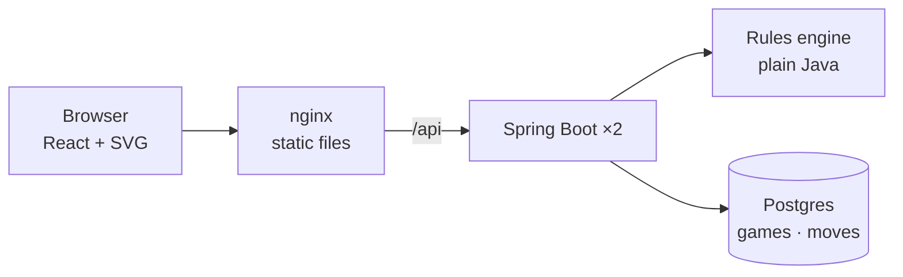

# Tavli Portes

Portes, the Greek form of backgammon, for two players taking turns on one screen. The server rolls the dice,
works out every legal move and checks each turn. The browser draws the board and lets players move one checker
at a time, with undo, before confirming. A **?** button in the app explains the rules for newcomers.

## Quick start

Needs Docker, [k3d](https://k3d.io), kubectl and make.

```sh
make up      # build the images, create a local k3d cluster, deploy, wait until ready
             # → http://localhost:8088
make smoke   # check the page loads and a game can be created
make down    # delete the cluster
```

`make up` is safe to re-run; it only restarts what was rebuilt. Without Kubernetes, `make compose-up` runs the
same images with docker compose on the same port (`make compose-down` to stop). Set `APP_PORT` to use another
port.

## How it fits together



- **Rules engine** (`backend/.../engine`): immutable records and no framework imports (a test enforces this).
  For a roll it builds a *turn graph*: every position reachable by moving one checker at a time. Different move
  orders that reach the same position share a node, so equivalent sequences are deduplicated without
  rejecting any order a player might choose. The forced-move rules (use as many dice as possible, else the
  higher die) decide which nodes finish a turn. Dead ends are pruned, so every move offered can be completed.
- **Server**: the dice are rolled only when a player asks. Each view of a game carries the turn graph. The
  client walks it locally, so moving and undoing are instant, and submits the moves taken. The server checks
  them against a fresh graph before applying them.
- **Storage**: `games` holds each game's current state as versioned JSONB. `moves` is an append-only log (a
  trigger rejects updates and deletes) of every opening throw, roll and turn. A test replays whole games from
  the log alone and gets the stored state back.
- **Concurrency**: each action locks its game row and carries the turn number it was made for, so double
  clicks or two tabs cannot apply a turn twice. The server holds no state between requests, which is why it
  runs two replicas.
- **Deployment**: multi-stage images (JDK → JRE, Node → nginx). nginx serves the UI and proxies `/api`, so
  compose and Kubernetes route the same way. In k8s, Postgres is a StatefulSet with a volume, the backend has
  Actuator probes, and Traefik's Ingress fronts nginx.

| Path | What |
|---|---|
| `backend/` | Spring Boot 4 / Java 25: `engine` (rules), `game` (service, persistence), `api` (REST) |
| `frontend/` | React + TypeScript + Vite: `api`, `game` (turn walking), `board` (SVG), `components` |
| `k8s/` | Kubernetes manifests, applied with `kubectl apply -k k8s` |
| `scripts/` | `make up` and `make smoke` |

## Rules as implemented

Standard Portes: 15 checkers each, standard starting position, players moving in opposite directions. Each
player throws one die to decide who starts, and the higher plays both dice (a tie is thrown again). Doubles
play four times. A single opposing checker can be hit and must re-enter before its owner moves anything else.
Two or more block a point. Bearing off starts once all 15 are home.

Decisions where the rules leave room (recorded in `engine/package-info.java`):

- A player with no legal move passes, using a button, so both players see the roll.
- A turn must use as many dice as possible; if only one die can be used, it must be the higher.
- A die higher than needed may bear off the farthest checker, but moving within the home board instead is
  also allowed.
- A checker hit while bearing off must come home again before bearing off continues.
- Bearing off the 15th checker wins immediately, even if a die is left over.
- When bearing off could use either die, the UI uses the lower one first (undo to choose the other).

Not included: the doubling cube, gammon scoring, and the other Tavli games (Plakoto, Fevga).

## Tests

```sh
make test     # backend and frontend unit tests, no Docker needed
make verify   # plus backend integration tests against a Testcontainers Postgres
```

- **Engine**: every rule, run for both colours, plus a cross-check of the turn graph against brute-force
  enumeration on random positions, and 50 random games played to a finish.
- **Backend integration**: schema constraints, persistence, the service (including simultaneous requests for the same turn), the
  REST API, and seeded whole games played over HTTP and replayed from the log.
- **Frontend**: turn-graph walking and board geometry (Vitest).

## Development

```sh
make db-up          # Postgres only, via docker compose
make backend-run    # Spring Boot on :8080; Flyway migrates on startup
make frontend-dev   # Vite on :5173, proxying /api to :8080
```

## API

Under `/api/games`; errors are [RFC 9457](https://www.rfc-editor.org/rfc/rfc9457) problem details.

| Method | Path | Body | Result |
|---|---|---|---|
| POST | `/api/games` | | `201` a new game, waiting for White's opening die |
| GET | `/api/games/{id}` | | `200` the game |
| POST | `/api/games/{id}/roll` | `{"turnNumber", "player"}` | `200`; `409` if it isn't that player's roll |
| POST | `/api/games/{id}/turns` | `{"turnNumber", "moves"}` | `200`; `409` stale or not rolled, `422` illegal |
| GET | `/api/games/{id}/log` | | `200` the full history, in order |

A game's `phase` says what it's waiting for: `OPENING`, `ROLLING`, `MOVING` (with `dice` and the `turn` graph)
or `FINISHED`. Board points are 24 signed counts (index 0 is point 1, positive is White). Moves look like
`{"from": 13 | "bar", "to": 7 | "off", "die": 6}`.

## Trade-offs and next steps

- **Local-only setup**: database credentials are committed for local use, images are imported into k3d rather
  than pushed to a registry, and there is no TLS.
- **One game per page**: a refresh starts a new game. There is no way to resume, and no accounts or networked
  play; the server is ready for that, but the UI is built for one shared screen.
- **Not added**: CI, monitoring, and autoscaling, all left out to keep the scope small.
