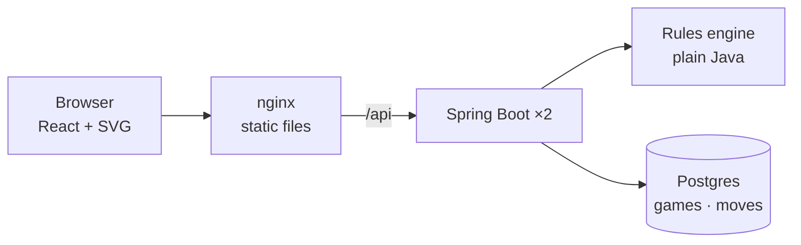

# Tavli Portes

Portes, the Greek form of backgammon, for two players taking turns on one screen.

## Quick start

With only Docker:

```sh
docker compose up --build   # → http://localhost:8088
```

On Kubernetes, which also needs [k3d](https://k3d.io), kubectl and make:

```sh
make up      # build the images, create a local k3d cluster, deploy, wait until ready
             # → http://localhost:8088
make smoke   # check the page loads and a game can be created
make down    # delete the cluster
```

Both use port 8088, so run one at a time, or pick another port with `APP_PORT=9000`.

## How it fits together



| Path | What |
|---|---|
| `backend/` | Spring Boot 4 / Java 25: `engine` (rules), `game` (service, persistence), `api` (REST) |
| `frontend/` | React + TypeScript + Vite: `api`, `game` (turn walking), `board` (SVG), `components` |
| `k8s/` | Kubernetes manifests, applied with `kubectl apply -k k8s` |
| `scripts/` | `make up` and `make smoke` |
